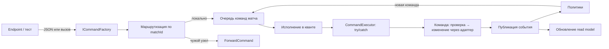

# Архитектура

Проект построен вокруг одной идеи: **любое изменение состояния — это команда**.
Всё остальное (очереди, скоупы, серверы, проекции) — инфраструктура вокруг команд.

## Слои

| Слой | Что внутри | Правило |
|---|---|---|
| Transport | `Endpoint` (JSON → команда), маршрутизация по хэшу, перенаправление | не знает домена, работает с именами команд |
| Application | команды, политики-обработчики, `ICommandFactory`, шина событий | оркестрация, без бизнес-правил |
| Domain | value objects, агрегаты через адаптеры, правила (Strategy/Specification) | не знает про IoC, очереди, JSON |
| Read models | проекции: лидерборд, история, территории, позиции | только чтение, пересобираемы |
| Infrastructure | IoC, генераторы адаптеров и регистраций, репозитории, очередь, scope, планировщик, пул серверов | всё «грязное» здесь |

## Поток исполнения команды



## Скоупы

```
RootScope   — аккаунты, юзернеймы, матчмейкинг, лидерборд, история, пул серверов, часы
 ├── MatchScope#1 — матч, поле, корабли, территории, доходы, балансы, проекции
 └── MatchScope#2
```

Текущий скоуп переключается на время исполнения команды матча и возвращается обратно.

## Правила, которые нельзя нарушать

1. `new` — только внутри стратегий разрешения зависимостей и регистраций.
2. `App.Ioc` вызывается только в composition root, регистрациях и сгенерированных адаптерах.
3. Все реализации доменных интерфейсов создаются генератором адаптеров, а не руками.
4. В домене нет `DateTime.Now`, `Thread.Sleep` и мутабельного `static`.

Правила 1–4 проверяются arch-тестами (см. [testing.md](testing.md)).
